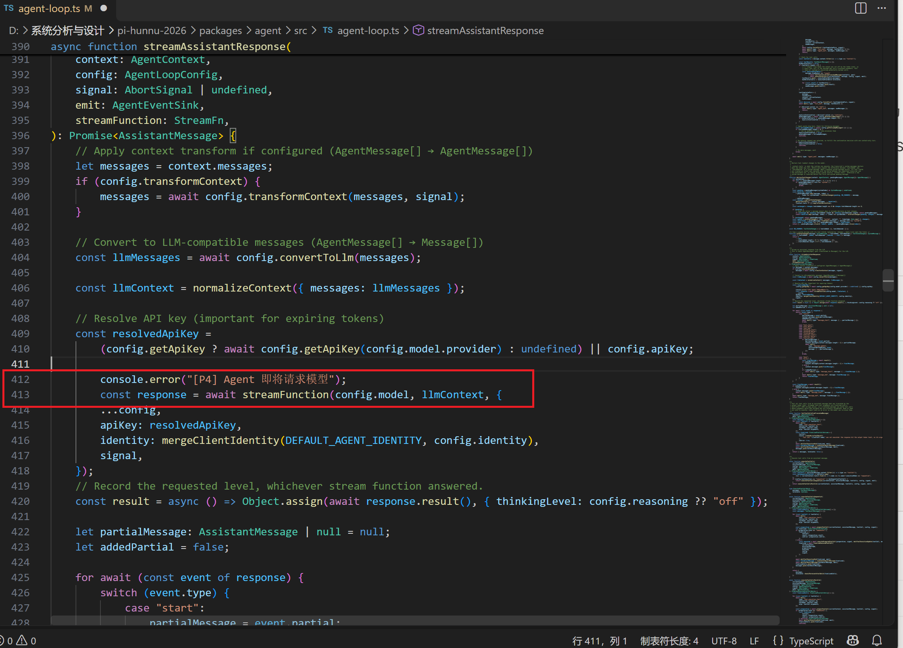
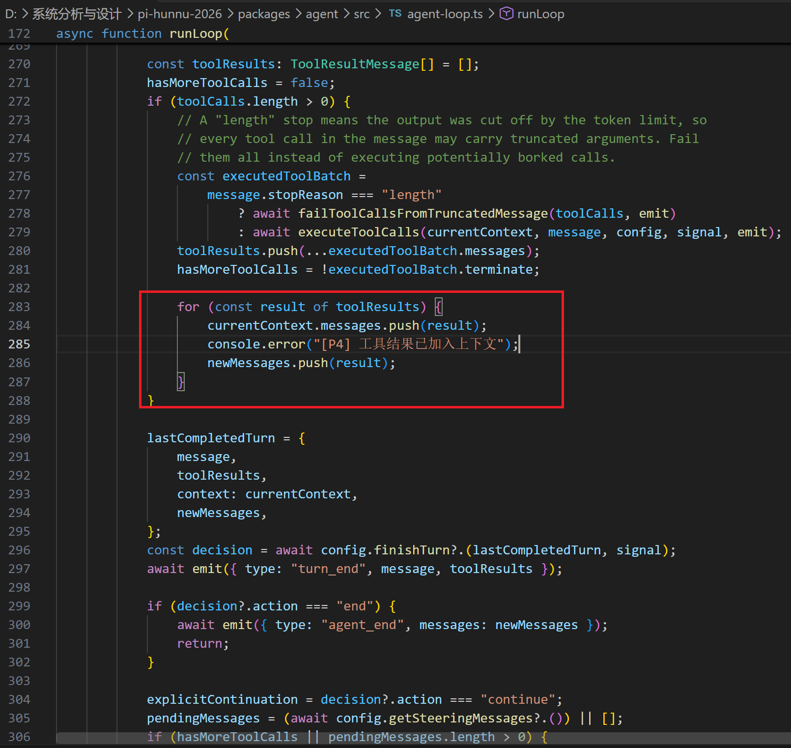
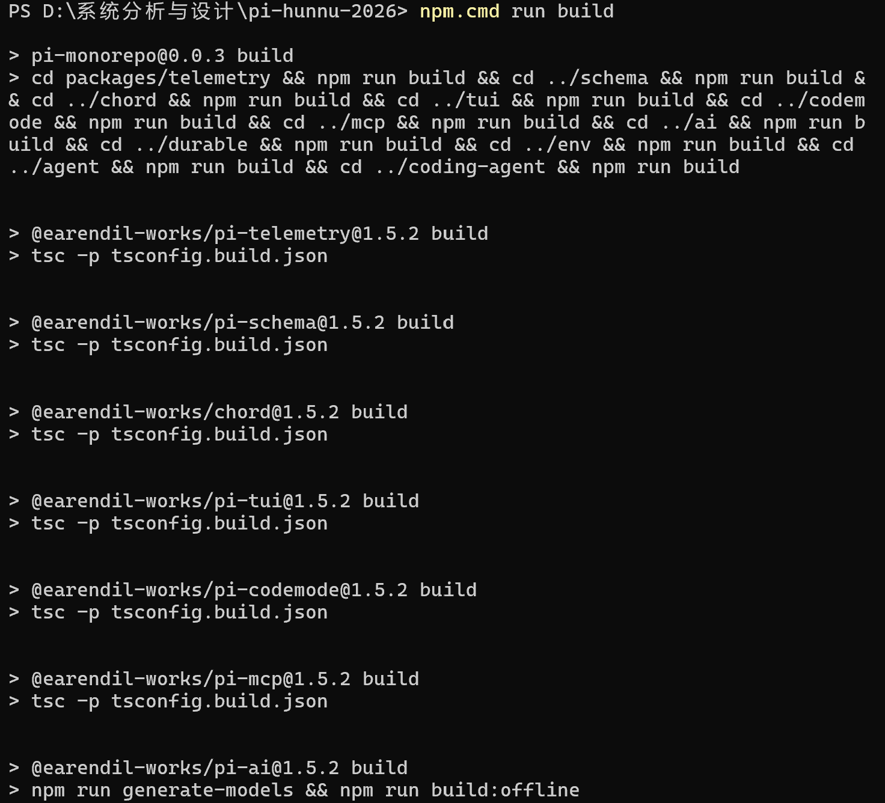
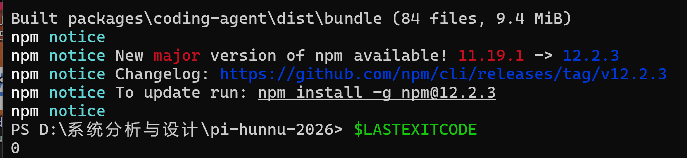
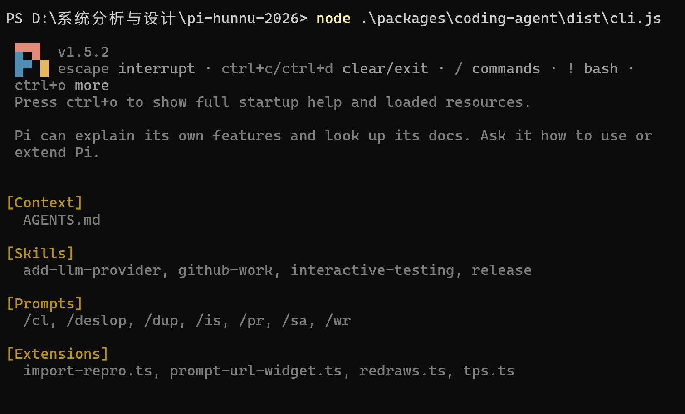
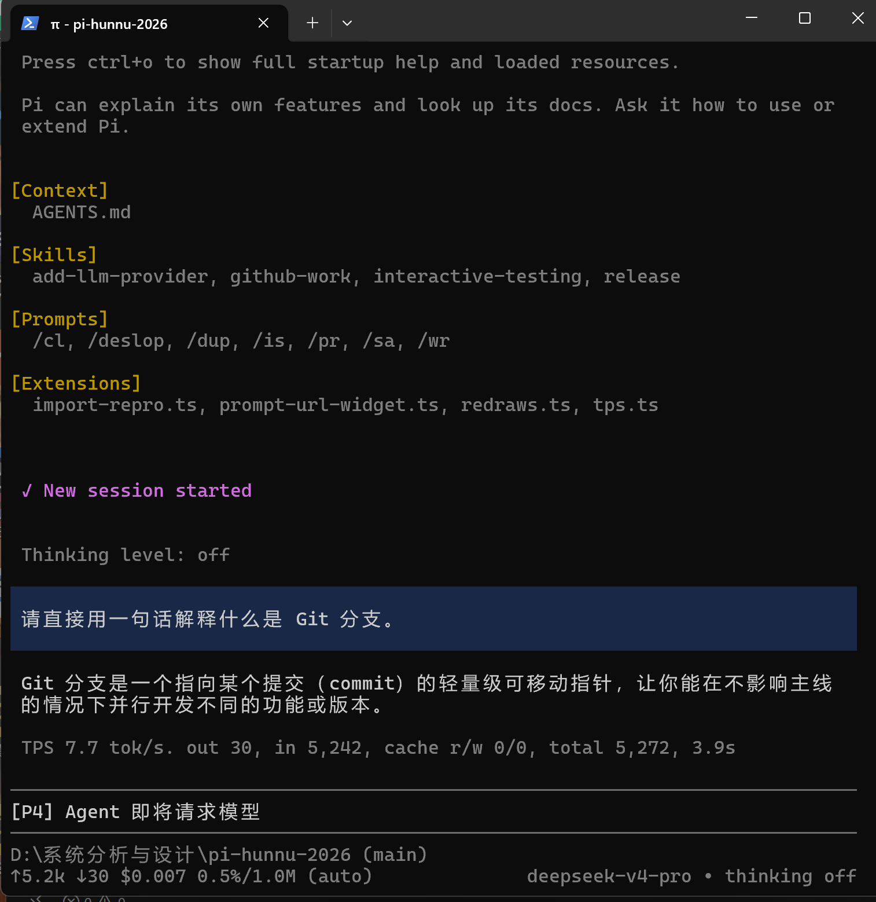
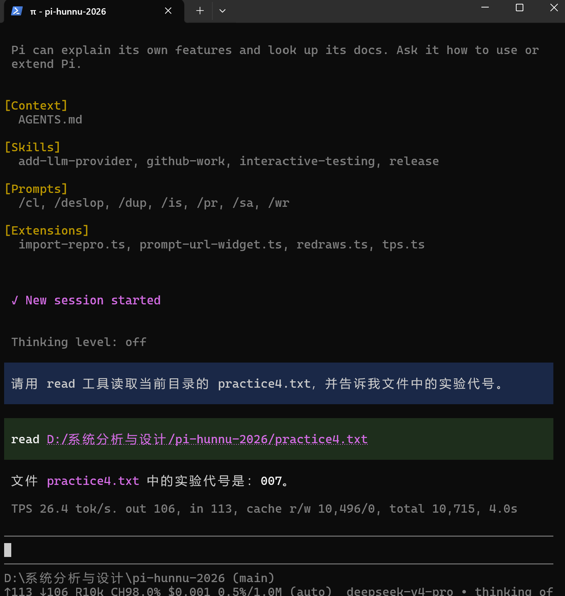
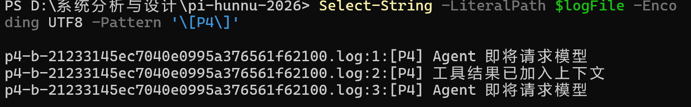
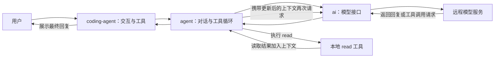

# 实践课 4：Pi Agent 的模型调用与运行流程

- 姓名：肖璟媛
- 小组仓库：<https://github.com/Wolf-F4/pi-hunnu-2026>
- 本地实验目录：`D:\系统分析与设计\pi-hunnu-2026`
- 实验所用基础提交：`c3cc91632d0a1950fb122605b190233f2aa0006e`；实验时在本地修改了源码。


## 一、实验目的

在 Agent 循环中增加两条日志，重新构建项目，通过直接问答和读取文件的对比，观察 Agent 到达模型调用位置以及工具结果进入上下文的过程。

## 二、源码修改

修改文件：`packages/agent/src/agent-loop.ts`。

### 1. 模型调用前

在 `streamAssistantResponse` 中，`await streamFunction(...)` 之前加入：

```typescript
console.error("[P4] Agent 即将请求模型");
const response = await streamFunction(config.model, llmContext, {
```



### 2. 工具结果加入上下文后

在遍历 `toolResults` 的循环中，`currentContext.messages.push(result)` 之后加入：

```typescript
for (const result of toolResults) {
    currentContext.messages.push(result);
    console.error("[P4] 工具结果已加入上下文");
    newMessages.push(result);
}
```



## 三、重新编译并启动

在项目根目录运行：

```powershell
npm.cmd run build
$LASTEXITCODE
```

由于 PowerShell 对 `npm.ps1` 的执行有限制，本次使用 `npm.cmd` 执行相同的 npm 构建脚本。根构建脚本依次构建各子包；执行结束后，退出码为 `0`。





构建成功后，按照作业要求直接启动编译产物：

```powershell
node .\packages\coding-agent\dist\cli.js
```



## 四、对比两次运行

两个会话使用相同模型 `deepseek-v4-pro`，推理强度均为 `off`。在项目根目录创建了 `practice4.txt`，其中的实验代号为 `007`；会话 B 的问题仅包含文件名，没有告诉模型代号。

### 会话 A：直接问答

**输入：**

> 请直接用一句话解释什么是 Git 分支。

**最终回复：**

> Git 分支是一个指向某个提交（commit）的轻量级可移动指针，让你能在不影响主线的情况下并行开发不同的功能或版本。

**观察：**截图中未见工具调用，显示 1 条模型调用日志，即本次可见 1 次到达模型调用位置：

```text
[P4] Agent 即将请求模型
```



### 会话 B：读取文件

**输入：**

> 请用 read 工具读取当前目录的 practice4.txt，并告诉我文件中的实验代号。

**工具调用：**截图显示 Pi 使用 `read` 读取 `practice4.txt`。

**最终回复：**

> 文件 practice4.txt 中的实验代号是：007。

**本次观察到的日志顺序：**

```text
[P4] Agent 即将请求模型
[P4] 工具结果已加入上下文
[P4] Agent 即将请求模型
```

本次单次会话显示 2 次到达模型调用位置，中间 1 条工具结果被加入上下文。交互界面未稳定保留所有日志，因此另外使用同一模型、同一文件，重新启动编译产物并在新会话中只提问一次，将标准错误输出重定向到新的本地日志文件，再筛选 `[P4]` 行。下方截图与该次单独记录对应。





- A 中截图未见工具调用，观察到 1 次模型调用日志，模型直接回答。
- B 中 Pi 本地的 `read` 工具实际读取文件；模型通过工具调用请求读取，而不是模型自己直接访问本地文件。

## 五、运行流程简图

下面是本次文件读取场景的简化示意：



## 六、总结

本次通过插入日志并重新构建，观察到直接问答和工具调用的不同。直接问答的截图中出现一次模型调用日志；读取文件的单独记录中，工具结果加入上下文后又出现一次模型调用日志。结合 `read` 工具记录和最终回复，说明模型能够基于本地工具返回的内容继续回答。
